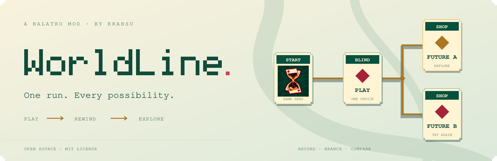
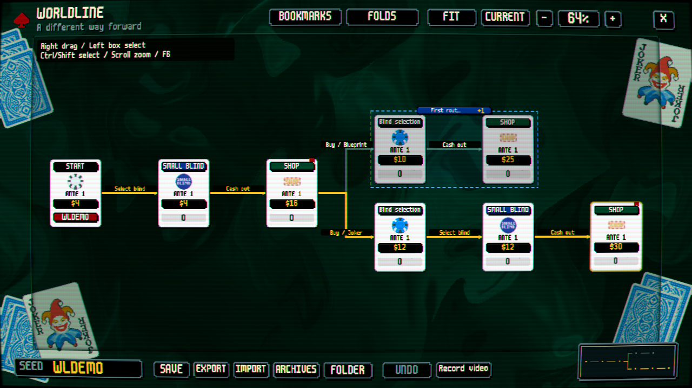

<picture>
  <source media="(prefers-color-scheme: dark)" srcset="docs/media/readme-hero-dark.svg" />
  <source media="(prefers-color-scheme: light)" srcset="docs/media/readme-hero-light.svg" />
  
</picture>

  <a href="https://github.com/KraHsu/balatro-worldline/releases">Download</a> ·
  <a href="https://github.com/KraHsu/balatro-worldline/blob/main/docs/usage.md">Usage guide</a> ·
  <a href="https://github.com/KraHsu/balatro-worldline/issues">Report an issue</a>

  
  

<strong>English</strong> · <a href="README_CN.md">简体中文</a>

<!-- WORLDLINE_HEADER_END -->

Explore the other way a Balatro run could have gone. WorldLine keeps a branching history of your run: return to an earlier stage, try another hand or shopping plan, and compare the results.

**Experimental release.** Tested with Balatro `1.0.1o-FULL`, Steamodded `26.1002.0`, and Lovely `0.10.0`. The interface follows the game's language and supports 15 languages, including English, Simplified Chinese, and Traditional Chinese.

[Downloads](https://github.com/KraHsu/balatro-worldline/releases/latest) · [Usage guide](https://github.com/KraHsu/balatro-worldline/blob/main/docs/usage.md) · [Development](https://github.com/KraHsu/balatro-worldline/blob/main/docs/development.md) · [Report a bug](https://github.com/KraHsu/balatro-worldline/issues)

*Interface preview using a synthetic run.*

## Features

- A left-to-right worldline of stage checkpoints, with choices summarized on connecting lines.
- Action-level **Ctrl+Z** undo for plays, discards, purchases, sales, and other irreversible actions.
- Return to a checkpoint and explore another branch. Identical recorded actions and complete states can reuse an existing branch.
- Bookmarks, named collapsible regions, selection, a draggable minimap, and snapshot comparison.
- Local resume, archive management, verified backups, and JSON sharing.
- Native Balatro cards, fonts, menus, and shaders loaded from your own game.
- Configurable video export of recorded routes using native gameplay animations and an external FFmpeg installation.

## Install

Close the game and back up your Balatro save directory before updating an experimental mod.

### Thunderstore

Install WorldLine with a compatible Thunderstore mod manager. Its package declares Steamodded and Lovely as dependencies. A ZIP imported as a local mod does not install dependencies automatically.

### Manual installation

1. Install [Lovely](https://github.com/ethangreen-dev/lovely-injector#manual-installation) `0.10.0` or newer and [Steamodded](https://docs.smods.dev/Installation/Installing%20Steamodded%20windows/) `26.1002.0` or newer. On Windows, Lovely's `winmm.dll` belongs next to `Balatro.exe`; Steamodded belongs in `%APPDATA%\Balatro\Mods\smods`.
2. Download the **manual-install ZIP** from [Releases](https://github.com/KraHsu/balatro-worldline/releases/latest) and extract it into `%APPDATA%\Balatro\Mods`.
3. Confirm that `Mods/WorldLine/WorldLine.json`, `main.lua`, and `lovely.toml` exist, then launch the game and check the Mods menu for **WorldLine**.

Replace the complete old `WorldLine` folder when updating. Install only one copy. **`WorldLine` is the Mod ID and install/data directory.** For upgrades from 0.6.3 or earlier, follow [the migration guide](docs/development.md#legacy-data-migration) before loading existing histories.

For source installations, copy the repository's `src/` directory as a folder named `WorldLine` in Mods. Other platforms use the upstream loaders' installation instructions; real-game testing is currently focused on Windows.

## CI downloads

Every push, pull request and manual Actions run builds and tests both distributions. Open the latest successful [Test and package run](https://github.com/KraHsu/balatro-worldline/actions/workflows/ci.yml) and download its two ZIP artifacts. The Thunderstore ZIP is ready to upload; the manual ZIP installs into Mods. Artifacts are retained for 30 days.

## Controls

| Action | Control |
| --- | --- |
| Open or close WorldLine | **F6**, or Options → WorldLine |
| Undo the last irreversible action | **Ctrl+Z**, or the top-right button |
| Restore a stage | Select its card → **Converge here** |
| Pan / zoom | Right-drag / mouse wheel |
| Select nodes | Left-drag, Ctrl to add, Shift-click for a path |
| Compare | Select exactly two nodes |
| Navigate the minimap | Drag its viewport; wheel zooms around the pointer |

Selection and card sorting do not create undo entries. Plays, discards, and individual shop actions do not create separate stage nodes. The incoming connection summarizes the phase's decisions; the Choices tab contains their details. Unfinished phase progress is saved separately for local resume.

## Achievements and seeded runs

| Use | Adds WorldLine's seeded-run restriction? |
| --- | --- |
| Passive recording, autosave, settings, automatic-creation toggle | No |
| Ordinary single-step undo | No; vanilla progression rules still apply |
| Confirmed continuous undo into older history | Yes |
| Open WorldLine, restore a checkpoint, browse/load archives, manually save, import/export, or open the data directory | Yes |

In an unseeded run, requesting a second consecutive undo displays a confirmation. Press Ctrl+Z again **within two seconds** to confirm. Expired confirmation does not execute the extra undo. An intervening new game action starts a fresh single-step undo sequence. Runs that are already seeded do not need this confirmation.

The restriction uses vanilla `GAME.seeded=true`; subsequent achievements and discoveries follow vanilla seeded-run rules. Restoring older checkpoints, restarting, or sharing cannot remove it. Previously written profile progress, cumulative statistics, and cloud-save history are not rewound.

Automatic worldline creation is enabled by default. Change it through **Options → WorldLine settings**. Existing histories remain available; enabling it midway through a run starts at the current stable state and does not invent earlier history.

## Saves and sharing

Data is stored in LÖVE's game data directory, normally `%APPDATA%\Balatro\WorldLine` on Windows. Archives alternate between two file generations. Deletion creates and verifies a backup first.

Use **Share export** to create a `.worldline.json` file. The recipient can drop it into the game window or place it in the `imports` directory and choose Import share. Both players should use the same game, Steamodded, and WorldLine versions.

## Video export

Select two checkpoints on the same route and choose **Record video** in the bottom bar. The start must be an ancestor of the end; endpoints can also be entered in the recording panel. Export runs from the starting checkpoint through the ending checkpoint's recorded actions.

Install [FFmpeg](https://ffmpeg.org/download.html) separately. Leave the FFmpeg path as `ffmpeg` if it is on PATH, or choose its executable with the recording panel's Windows file picker. The output directory button opens a folder picker; **Enter path** keeps manual editing available. Text editors support held Backspace, Unicode and paste. FFmpeg is not bundled. Configure game speed (0.25–8x), 30/60 FPS, the gap between actions, pauses before using consumables, and previews of every card in opened packs.

Export displays a native progress bar and a Cancel button. Your current run stays paused and is never reconstructed for playback. A separate, lower-priority Windows process replays the route on a private desktop, with Steam disabled and separate profile, Mods, and temporary directories. Esc cancels the export.

Videos are **silent H.264 MP4s** at 30 or 60 FPS. Choose 720p, 1080p, or **2K (2560×1440)** independently of your game window. The default is 720p; 2K displays a resource warning because it requires more GPU memory, encoding time and output disk space. Configure **Video output directory** with an absolute path; an empty setting uses `WorldLine/recordings` inside the game data directory. The directory is created when export starts. FFmpeg and output paths support spaces and non-ASCII characters.

Playback uses native callbacks and animations. It does not add nodes or move the worldline cursor. Incomplete action records show an orange warning and allow export when the required inputs exist; playback order may differ from actual play. Endpoint state/RNG mismatches or missing target cards still report playback errors.

The private renderer runs independently of output FPS and streams raw frames directly to FFmpeg, without writing PNG intermediates. Rendering and encoding overlap, with at most three unacknowledged frames in memory. Short clips still include the fixed cost of starting the separate game process; export speed depends on resolution, hardware and scene complexity. Background video export currently supports **Windows**. FFmpeg is not bundled.

## Limitations

- This is an experimental mod. Compatibility with other gameplay mods, tutorial states, and intermediate animation frames is not guaranteed.
- Restores preserve recorded gameplay state and named random streams. Equivalence with vanilla has **not** been proven for every possible action sequence. Randomness that vanilla does not determine from the run seed remains outside that guarantee; missing information in old recordings cannot be reconstructed reliably.
- A worldline is limited to 10,000 nodes and 128 MiB per file. Large histories may still take time to load, lay out, or explicitly export.
- Normal exit waits for pending saves and cancels exit if saving fails. Force-closing the process can lose progress that has not reached disk.

## Development and attribution

See [the architecture](docs/architecture.md), [contribution guide](CONTRIBUTING.md), and [changelog](CHANGELOG.md).

Build a manual-install ZIP with `python tools/build.py`. See the [development guide](https://github.com/KraHsu/balatro-worldline/blob/main/docs/development.md) for regression tests, packaging, and isolated real-game testing. Tests passing does not replace real-game compatibility or visual checks.

The original WorldLine code is by **KraHsu**, under the [MIT License](https://github.com/KraHsu/balatro-worldline/blob/main/LICENSE). AI tools assist development; the project includes offline regression tests and has been exercised in real Balatro sessions. The Thunderstore icon is AI-generated original artwork.

Balatro is by LocalThunk and published by Playstack. This unofficial mod is not endorsed by them. Game executables, fonts, textures, shaders, Steamodded, and Lovely are **not bundled**. Runtime artwork comes from the user's game installation. See [NOTICE](https://github.com/KraHsu/balatro-worldline/blob/main/NOTICE.md).
