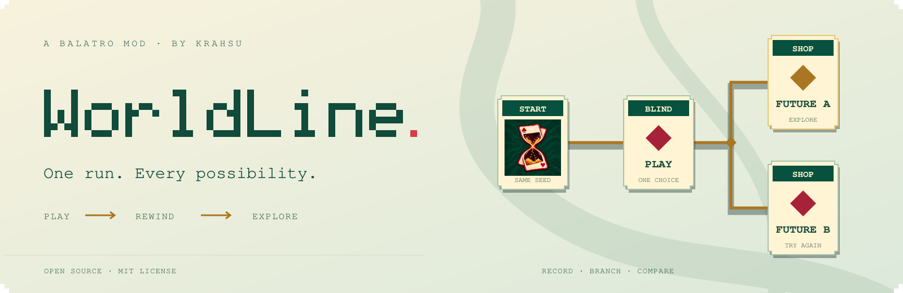
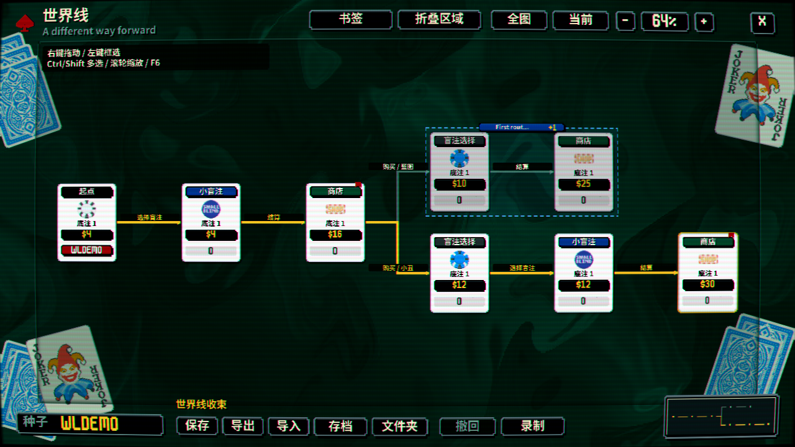

<picture>
  <source media="(prefers-color-scheme: dark)" srcset="docs/media/readme-hero-dark.svg" />
  <source media="(prefers-color-scheme: light)" srcset="docs/media/readme-hero-light.svg" />
  
</picture>

<p align="center">
  <a href="https://github.com/KraHsu/balatro-worldline/releases">下载模组</a> ·
  <a href="https://github.com/KraHsu/balatro-worldline/blob/main/docs/usage_cn.md">使用指南</a> ·
  <a href="https://github.com/KraHsu/balatro-worldline/issues">反馈问题</a>
</p>

<p align="center">
  <a href="https://github.com/KraHsu/balatro-worldline/actions/workflows/ci.yml"></a>
  <a href="LICENSE"></a>
</p>

<p align="center"><a href="README.md">English</a> · <strong>简体中文</strong></p>

<!-- WORLDLINE_HEADER_END -->

**Balatro 世界线模组**：保存一局牌的分支历史，回到先前阶段尝试另一种打法或购物方案，再比较两条路线。支持单步撤回、本地续玩、书签、节点对比和 JSON 分享。

**当前版本：0.6.5 实验版。** 验证基线为 Balatro `1.0.1o-FULL`、Steamodded `26.1002.0`、Lovely `0.10.0`。界面跟随游戏语言，支持包括简体中文、繁体中文和英语在内的 15 种语言。

[下载](https://github.com/KraHsu/balatro-worldline/releases/latest) · [使用指南](docs/usage_cn.md) · [架构说明](docs/architecture.md) · [开发与测试](docs/development.md)



*使用合成样例局面的界面预览。*

## 安装

以下步骤以 Windows Steam 版为例。开始前退出游戏，并备份 `%APPDATA%\Balatro`。

1. 按官方说明安装 [Lovely](https://github.com/ethangreen-dev/lovely-injector#manual-installation) 和 [Steamodded](https://docs.smods.dev/Installation/Installing%20Steamodded%20windows/)。Windows 下，Lovely 的 `winmm.dll` 放在 `Balatro.exe` 旁；Steamodded 放在 `%APPDATA%\Balatro\Mods\smods`。最低依赖为 Steamodded `26.1002.0`、Lovely `0.10.0`；上方版本组合是当前验证基线。
2. 从 [Releases](https://github.com/KraHsu/balatro-worldline/releases/latest) 下载 `WorldLine-0.6.5.zip`，解压到 `%APPDATA%\Balatro\Mods`。最终应有：

   ```text
   %APPDATA%\Balatro\Mods\WorldLine\
   ├─ WorldLine.json
   ├─ main.lua
   ├─ loader.lua
   ├─ lovely.toml
   ├─ domain/ runtime/ storage/ ui/ video/ platform/ workers/
   ├─ assets/
   └─ localization/
   ```

3. 启动游戏，在 Mods 列表中确认 `WorldLine 0.6.5` 已加载。开始一局，默认会在稳定状态自动建立世界线，无需输入种子。

更新时退出游戏，用新版完整替换旧 `WorldLine` 文件夹，避免同时安装多个版本。**Mod ID、安装目录和数据目录均为 `WorldLine`。** 从 0.6.3 或更早版本升级时，请先按[迁移说明](docs/development.md#legacy-data-migration)转换已有记录。

从源码安装时，只将本仓库的 [`src/`](src) 文件夹复制到 Mods，并将其命名为 `WorldLine`，或按[开发指南](docs/development.md#build)生成 ZIP；不要把整个仓库放进 Mods。其他平台的依赖安装方式见上游文档，本项目的实机验证目前以 Windows 为主。

## 第一次使用

- **F6** 打开或关闭世界线，也可使用「Esc / 选项 → 世界线 / F6」。动画中请求打开会等待当前操作完成；文本框内需先结束输入。
- **Ctrl+Z** 撤回最近一次不可逆操作，也可使用游戏右上角的按钮。单纯选牌、排序不会占用撤回点。
- **点击阶段卡牌 → 收束到此** 恢复该阶段；改变选择并进入下一阶段，会留下另一条分支。
- **右键拖动**平移，**滚轮**缩放；**左键拖动**框选，**Ctrl+点击 / 框选**累加选择，**Shift+点击**选择两点之间的路径。
- 选中一个节点可查看详情、阶段选择和书签；选中恰好两个节点可对比快照。缩略图可拖动定位，完整快捷键见[使用指南](docs/usage_cn.md#画布与快捷键)。

世界线记录的是**阶段**：起点、选择或跳过盲注、领取奖金进入商店、离店，以及失败终点。出牌、弃牌和商店内操作不会各自增加节点；连线概括阶段内的选择，目标节点的「选择」页提供明细。未完成阶段的进度会另外保存，重新载入时可接着玩。

快速输入会保留原来的卡牌目标和选牌，等上一段动画结束后执行；卡牌或阶段已经改变的排队操作会取消并提示。撤回栈仅保留本次游玩的最近 200 个已完成操作，退出后不保留；旧版已经缺失的撤回点无法补回。

## 成就与种子局规则

| 操作 | WorldLine 额外设置种子局标记？ |
| --- | --- |
| 自动记录、自动保存、打开设置或切换自动创建 | 否 |
| 普通单步撤回 | 否，仍遵循原版进度判定 |
| 非种子局连续向更早历史撤回，并确认提示 | 是 |
| 打开世界线、收束到节点、浏览或载入存档、手动保存、导入导出、打开数据目录 | 是 |

非种子局第一次撤回后，紧接着再按 Ctrl+Z 会显示确认；**在 2 秒内再按一次**才执行连续撤回并标记为种子局。超时或取消不执行这一步。撤回后进行了新的原版操作，再单步撤回不算连续撤回。

种子局标记使用原版 `GAME.seeded=true`，后续成就和新发现遵循原版种子局限制。它随牌局保存，回到旧节点、重启或分享都不能解除；此前已写入的档案进度不会回滚。WorldLine 也不会回滚原版累计统计或云存档历史。详见[撤回与进度规则](docs/usage_cn.md#撤回与进度规则)。

## 主要功能

- 存档和备份采用左右分栏：先选记录、查看摘要，再明确载入；支持重命名、分支导出、分支删除及备份恢复。
- 存档、备份和设置面板直接覆盖在世界线上，返回时保留视野与选择；面板打开期间阻止底层画布操作。
- 存档摘要由独立只读线程按需读取并缓存。保存分帧编码、后台写入，收到完成回执后才提示保存成功。
- 撤回保留已经访问的历史；在同一父节点下，操作顺序和完整局面一致的路线可复用已有分支。

「选项 → 世界线设置」可关闭自动创建。该开关影响尚未创建世界线的牌局，已有记录继续保留和记录；重新开启后从当前稳定局面开始，不补录此前历史。

## 保存、分享与局限

数据保存在 LÖVE 游戏数据目录；Windows 通常为 `%APPDATA%\Balatro\WorldLine`。本地存档采用两个交替文件代际，删除前创建并验证备份。使用底栏「分享导出」获得 `.worldline.json`；接收方可将它拖入游戏窗口，或放入 `imports` 后选择「导入分享」。双方应使用相同游戏、Steamodded 和 WorldLine 版本。见[保存与分享](docs/usage_cn.md#保存与分享)。

- 当前为实验版，尚未保证与其他玩法 Mod 兼容，也不保证动画中间帧、教程中间状态或第三方自定义状态的恢复。
- 恢复会保留已记录的玩法状态和命名随机流；**尚未证明任意操作序列都与纯原版严格等价**。原版不由关卡种子完全确定的部分仍有自身差异，旧记录缺失的信息也不会补造。
- 每条世界线上限为 10,000 个节点，单文件上限为 128 MiB。达到限制会报错并保留历史；大记录的载入、布局和显式导出仍可能耗时。
- 正常退出会等待保存，失败时取消退出以便重试；强制结束进程仍可能丢失尚未落盘的进度。

## 录像导出

选中同一路线上的两个节点，点击底栏「录制」。开始节点必须是结束节点的祖先，也可以在录制面板填写节点编号。配置游戏速度、30/60 FPS、操作间隔、消耗牌使用前的信息停顿，以及依次展示卡包所有卡牌。

需要单独安装 FFmpeg；可以使用 PATH 中的 ffmpeg，或点击「FFmpeg 路径」打开 Windows 文件选择器。点击「视频导出目录」打开目录选择器；旁边的「输入」按钮保留手动编辑，支持长按退格、中文与粘贴。目录留空时使用游戏数据目录的 `WorldLine/recordings`。目录会自动创建，支持中文、空格路径。

导出时显示原版样式的进度条与取消按钮，当前牌局保持暂停，不会载入回放快照。实际回放由另一个低优先级进程在独立桌面完成，禁用 Steam，使用独立的档案、Mod 和临时目录。Esc 可取消。输出为 30/60 FPS 的无声 H.264 MP4，可选 720p、1080p、2K（2560×1440），与当前窗口大小无关。默认 720p；2K 会显示资源警告，提示显存、编码耗时和输出文件占用增加。

导出不会改变当前世界线位置和分支。“操作记录不完整”改为橙色警告，有实际操作输入就可以继续导出，录像中的操作顺序可能与实际游玩不同。阶段终点仍校验局面和随机状态；实际缺少目标卡牌或回放状态不一致时会报告具体错误。

后台渲染速度与输出帧率分离，原始画面直接传给 FFmpeg，边渲染边编码，不再压缩和写入 PNG 临时帧。内存中最多保留三个待确认帧。短片仍包含独立游戏进程的固定启动时间，实际速度取决于分辨率、硬件与场景复杂度。目前后台导出仅支持 Windows。

## 开发

[`src/`](src) 是主要模组，[`tests`](tests) 是离线 Lua 回归测试，[`tools`](tools) 提供打包和测试工具。[开发指南](docs/development.md)包含打包、依赖、隔离实机验收和问题报告说明；[架构说明](docs/architecture.md)介绍记录、恢复、存储和界面的边界。

项目代码采用 [MIT 许可证](LICENSE)，作者 KraHsu。游戏素材由运行中的 Balatro 提供，不随发行包分发。见 [NOTICE](NOTICE.md)。

WorldLine is an experimental Balatro mod for branching run history, undo, local resume, and JSON sharing. Install only the `WorldLine` folder with Lovely and Steamodded. Opening WorldLine or confirming continuous undo marks the run as seeded; passive recording and ordinary single-step undo do not add that mark.
