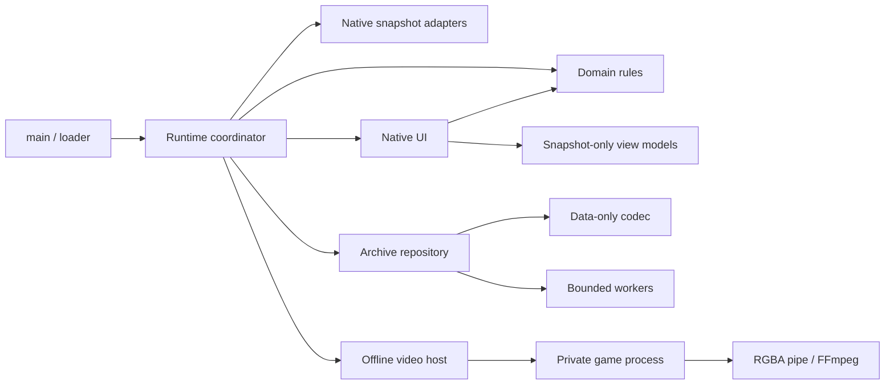

# Architecture

[README](../README.md) · [Development](development.md) · [Contributing](../CONTRIBUTING.md)

WorldLine is a Steamodded mod with a Lovely draw hook. The source, install directory, Mod ID, and data directory have distinct roles: source lives in `src/`, packages install as `Mods/WorldLine/`, and player records live in the game's data directory under `WorldLine/`.

## Layout and ownership

| Directory | Responsibility |
| --- | --- |
| `src/domain/` | Immutable tree checkpoints, choices, branch matching, progress restrictions and root pool conditions |
| `src/runtime/` | Application/session coordination, native callback observation, Undo, state capture/restore and game adapters |
| `src/storage/` | Data-only codec, archive repository, generation recovery, backups and browser protocol |
| `src/ui/` | Native menus, graph layout, selection, drawing, snapshot details, comparison and localization lookup |
| `src/video/` | Recording plans, offline renderer supervision, native playback and FFmpeg pipe |
| `src/platform/` | Windows processes, filesystem helpers and native file pickers |
| `src/workers/` | Bounded save, archive-browser, encoder and picker worker entry points |
| `src/localization/` | All 15 native game languages |
| `src/assets/` | Original project icon; gameplay art comes from the running game |

`src/main.lua` only loads the application through `src/loader.lua`. The registry owns all module paths and the canonical Mod ID. It works after Steamodded clears `current_mod`, with ZIP-mounted installs, and in offline tests. Workers receive known source text and plain messages rather than a mutable game object.

## Three histories

| Data | Granularity | Lifetime |
| --- | --- | --- |
| Public tree | Stable stage entries: start, blind selection, shop entry/exit and run end | Saved and shared |
| Resume checkpoint | Latest stable progress within the current stage | Saved and shared, without an extra graph node |
| Undo stack | State before one irreversible operation | Current session only, bounded to 200 entries |

Native callbacks record ordered inputs, including the global playing-card order that deck viewing can change and pre-action card counters consumed by native previews. Stable-boundary observation confirms their effects and commits stage transitions. Selecting a card does not become an action.

The session input queue retains up to 16 pending player callbacks, their card references and hand selections. It dispatches one at a stable boundary, after the preceding action has been finalized. Changed cards, rounds or blinds cancel stale inputs. Native event-manager continuations bypass this queue and remain part of their parent action. The queue is transient and does not alter RNG or reconstruct missing legacy inputs.

The event policy identifies native `juice_card_until` pulses by their scheduling context. These recurring cosmetic events do not prevent stable checkpoints; otherwise DNA's first-hand pulse could block the player action needed to end that pulse. Their native scheduling and callbacks remain untouched. Unidentified nonblocking events still count as pending gameplay work.

Branch reuse compares children of the current node. Both operation order and complete seeded gameplay state must match. A matching summary alone is insufficient. Incomplete historical evidence creates a separate branch.

## Restore and seeded behavior

Restore validates the archive and snapshot, then rebuilds the native scene at a frame boundary. It preserves named RNG streams, gameplay card identity and recorded order. Poker-hand candidate enumeration is stored separately because copying a Lua table can change its `pairs` order. Only registered restored hand maps use that enumeration; ordinary tables keep native iteration behavior.

Before restoring highlighted consumable controls, the card adapter derives eligibility caches from the restored Joker inventory without running gameplay updates. A separate visual adapter synchronizes copied Planet discovery-bypass flags and sprite positions without consuming RNG, changing card identity or modifying profile discoveries.

Deck metadata and summaries store only the Back key. Native `GAME.selected_back_key` can be a Steamodded object with methods such as `inject`; restore retains the reference reconstructed by native `start_run`, rather than applying its serialized object placeholder. Older object-shaped presentation fields are normalized on import without rewriting their gameplay snapshots.

The native load boundary discards `GAME.viewed_back`, a menu/collection preview that the save format culls but the run loader never reconstructs. Continue and checkpoint loads use the real selected deck from `BACK`; source files remain untouched. Branch matching and video verification ignore only this preview field, while the selected deck and seeded gameplay remain strict. Backup loading also tolerates an unconstructed previous blind left by a partial load. If both loads fail, the menu gets a fresh event manager so abandoned `no_delete` events cannot run against the new scene.

The progress adapter keeps the seeded-run restriction monotonic. Passive recording and ordinary single Undo retain vanilla eligibility; explicit worldline features and confirmed continuous Undo apply the restriction. Candidate-pool adapters temporarily use the root profile conditions and restore the real profile afterwards.

Imported files are JSON data, never executable Lua. Native profiles, discoveries and cloud history are not rewound. Compatibility is tested for the documented engine/loader baseline, not every possible action sequence or third-party mod.

## Storage and threads

The main thread encodes saves in cooperative slices. A writer consumes bounded text chunks and acknowledges the exact generation/ticket. Only that acknowledgement clears pending state. Records alternate between two generations. Errors retain the in-memory revision for retry; normal exit waits for pending writes.

Archive browsing has a separate read-only worker that returns compact summaries. Serial numbers, file signatures and cache generations reject stale replies. Opening the browser triggers work; normal saves only invalidate its cache.

Deletion verifies a backup first. Restoring a backup creates a new run ID. Sparse node IDs survive pruning and partial export.

## Rendering and playback

UI view models read snapshots without restoring a game or consuming gameplay RNG. Lovely composites the graph before the native cursor and CRT/ScreenShader pass. Native overlays own input while open and return the previous view after closing.

Video export pauses the visible run and uses a separate offline game process with its own identity, profile, Mods directory and private Windows desktop. Simulation uses fixed output-frame time; the render loop can run faster than playback. A worker streams RGBA frames directly to FFmpeg. At most three unacknowledged frames are retained. Cancellation releases the process tree and partial output.

Playback checks stage state and named RNG. Legacy routes with no blind skips may differ in an unused orbital-tag cache because old snapshots did not preserve hand enumeration; that cache is exempt only for such routes, with a warning. Used tags, hand levels, money, cards and RNG remain checked. Final inventory/hand arrangement is replayed as recorded player input and must contain the same cards; card values are not replaced.

Legacy UI previews could consume unrecorded sort IDs. `video/identity.lua` translates references through a monotone bijection of live cards, preserving relative RNG candidate order without rewriting actual card IDs or random streams. Ambiguous targets, aliases and order reversals fail. Native current playing-card serials also require a bijection because removal can reindex them. Legacy comparison excludes constructor-only `params.playing_card` metadata, which native load can omit and copying can overwrite through an aliased table. New recordings retain counters and use exact sort IDs.

Verification excludes native hover caches, unused top-level consumable `mod_num` copies and playing-card-centre entries in `used_jokers` (the Enhanced pool bypasses that map). Actual consumable limits and Joker/Tarot/Planet duplicate suppression remain strict. A recorded post-win cashout can dismiss the exact native victory overlay through its Endless callback. Playback never injects a target checkpoint to conceal a failed action.
